# GLOBIAS 2026 · Group 5 · Assignments I & II

**Twelve years later: re-running ilastik's MitoCheck tracking example**

On 21 October 2026, in one cloud session, Claude (an AI assistant) and I re-ran ilastik's MitoCheck
tracking example: a 53-frame movie of cell nuclei (MitoCheck movie 94570; files dated 2013), together
with the pixel classification and tracking projects that were trained by hand in 2014. Everything ran
headless, with no GUI. The goal was the final tracking labels. Getting there meant working through a
series of walls (software that no longer installs, file formats that moved on, a 2018 binary on a 2026
system) and correcting two of Claude's own claims along the way.

<p align="center">
  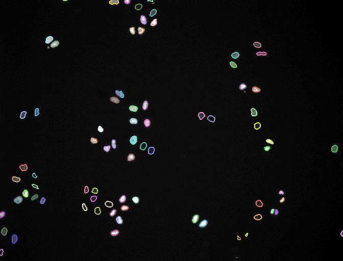
  <br><sub>The result (ilastik 1.3.3post3): every lineage outlined in its own colour across 53 frames; grey = detected but not tracked.</sub>
</p>

The technical details (file formats, every change made to the 2014 projects, how to reproduce the run)
are in [docs/REFERENCE.md](docs/REFERENCE.md). This page tells the story.

> **About the images below.** The terminal pictures are renderings of real output: log files and
> command output from this session, re-run where possible, stored as text in
> [`docs/chronicle/screens/`](docs/chronicle/screens/) and drawn by
> [`docs/chronicle/make_images.py`](docs/chronicle/make_images.py). They are not literal screenshots of
> the chat. `[…]` marks lines left out; blue lines are annotations, not program output.

---

## The brief

My requests, verbatim, in the order I wrote them:

1. *"I want you tu run ilastik and create some results frombthe demo data"*
2. *"I want to run the mitocheck example workflow, and get the resulted labels at the end. Save
   everything from each step of what your work here, on the repo."*
3. *"ok, maybe run it on ilastik 1.3.1 post? if you have issues. I worked on it back then and it was
   fine."*
4. Show the tracking GIFs, make a side-by-side GIF, and write this chronicle.

What that meant in practice: install ilastik in an empty cloud container, apply the **pre-trained**
2014 projects without re-labelling anything, keep every intermediate file, and commit it all.

## Timeline (UTC, from log and file timestamps)

| time | what happened |
|---|---|
| 04:51 | empty repo; ilastik's servers blocked by the sandbox network policy |
| 04:58–05:08 | ilastik 1.4.1 won't install from conda; 1.5.0a3 (alpha) does |
| 06:48 | network access granted; the example zip arrives |
| 06:49–06:52 | three failed attempts at pixel classification, then success on ilastik 1.5 |
| 06:54–06:56 | three failed attempts at tracking, then success on ilastik 1.5 |
| 06:57 | request to use ilastik 1.3.1 |
| 06:59 | ilastik 1.3.2post1 crashes |
| 07:01–07:04 | ilastik 1.3.3post3: pixel classification and tracking succeed |
| 07:33–08:02 | clean re-run of the whole pipeline from the committed scripts |
| 13:45 | side-by-side GIF; this chronicle |

---

## 1. A closed door

The repository contained a one-line README. The container had Python but no ilastik, and the
network policy blocked GitHub, `ilastik.org` and `data.ilastik.org`. The conda channels were open.

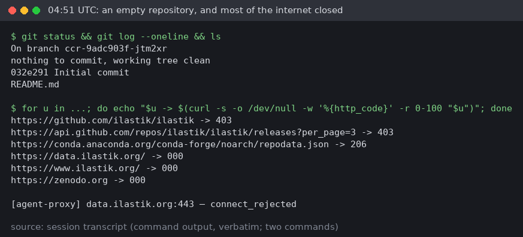

Software could come from conda, but there was no workaround for the data: the example only exists on
`data.ilastik.org`. Claude asked, and I added that domain to the environment's allowed hosts.

## 2. The solver says no

ilastik 1.4.1, the current stable release, no longer installs from the conda channels: its pinned
dependencies conflict with what the channels carry in 2026. The newest pre-release, 1.5.0a3,
resolved straight away.

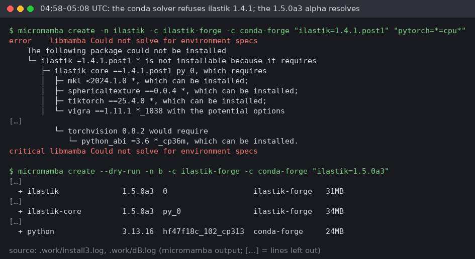

So the first working ilastik was an alpha version, which matters for how much weight its results carry.
It's why the 1.3 run later became the main one.

## 3. The parcel

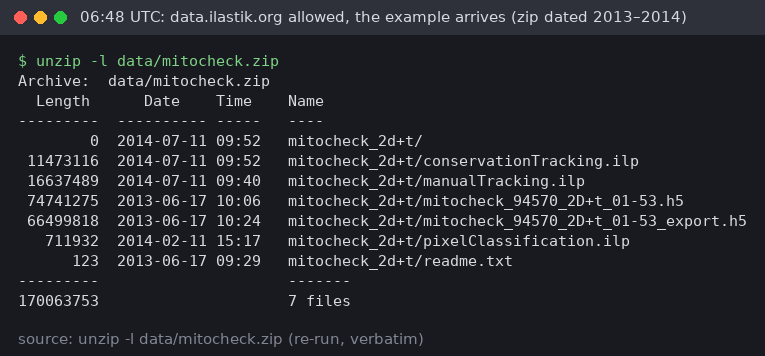

Inside: the raw movie (2013), a pixel classification project (February 2014), a conservation-tracking
project (July 2014), a manual-tracking project, and `mitocheck_94570_2D+t_01-53_export.h5`, the
probability map exported from the pixel classifier in 2013.

> **Before you scroll:** you're short on disk space. Which file in the zip looks safest to delete?
>
> <details><summary>Answer</summary>
>
> `…_export.h5` looks like a disposable intermediate: step 2 regenerates it. But the tracking project
> refuses to open without it (chapter 5). Its object-count and division classifiers were trained on
> exactly that file, and the project stores its path.
> </details>

## 4. Labels that fall off the edge

The first wall was small. The project stores the movie's path *relative to the project file*, so a copy
of the project in another folder can't find it. Linking the movie next to the copy fixed that.

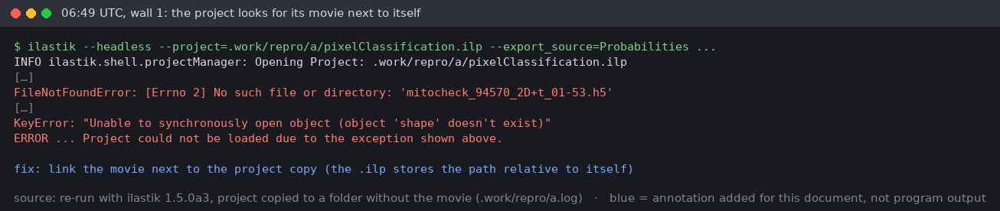

The second wall was more interesting:

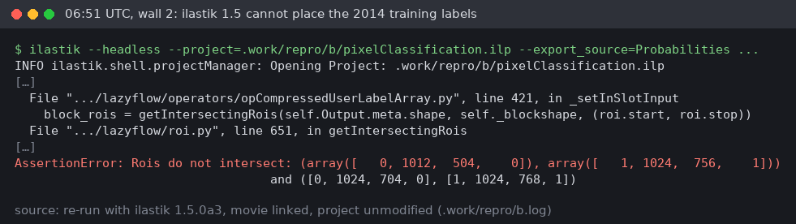

> **Puzzle:** the movie is 1344 × 1024 pixels. ilastik complains that a stored label block covering
> 1024–1088 on axis 1 doesn't intersect the image. Is the 2014 project corrupt?
>
> <details><summary>Answer</summary>
>
> No. Axis 1 has 1344 pixels in the file on disk (order `t, x, y, c`), so 1024–1088 is well inside.
> ilastik 1.5 works internally in `t, y, x, c` order, where axis 1 is y and only 1024 pixels long.
> The labels were saved in the file's own axis order and are now read in a different one.
> </details>

The diagnosis: print where the 2014 label blocks sit, then hook into ilastik 1.5's project loader to
print the shape it expects for them.

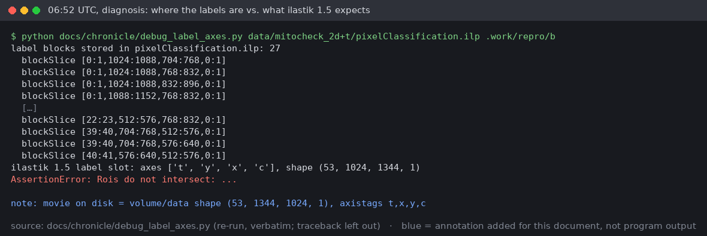

Drawn on the first frame, the mismatch is easy to see. Each square is a 64 × 64 storage tile that
contains some of the 2014 brush strokes:

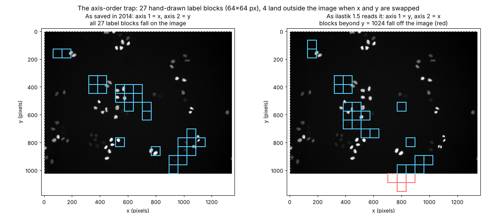

One dead end first: writing the movie's axis tags into the project changed nothing, because ilastik 1.5
reorders to `t, y, x, c` regardless. What did work
([`scripts/fix_legacy_labels.py`](scripts/fix_legacy_labels.py)) was swapping x and y in each stored
label block and in its coordinates, so every brush stroke lands on the same pixel as in 2014. With
that, ilastik 1.5 applied the 2014 classifier to all 53 frames in about a minute.

## 5. The tracking project

The tracking project put up two more walls. It wouldn't open without its 2014 probability map (see the
answer in chapter 3). Once that was linked in, batch processing stopped at a missing parameter:

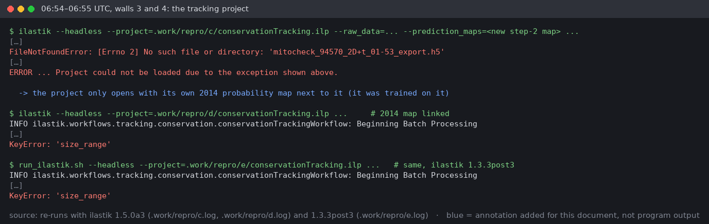

The parameter was there, just one folder deeper. The 2014 file stores the tracking settings per image
lane (`Parameters/0/size_range`), and newer ilastik reads them from `Parameters/size_range`.
[`scripts/fix_legacy_tracking_params.py`](scripts/fix_legacy_tracking_params.py) moves them up
unchanged. One setting didn't exist in 2014 (`max_nearest_neighbors`, how many candidate cells in the
next frame each cell may be linked to) and was set to today's default, 3.

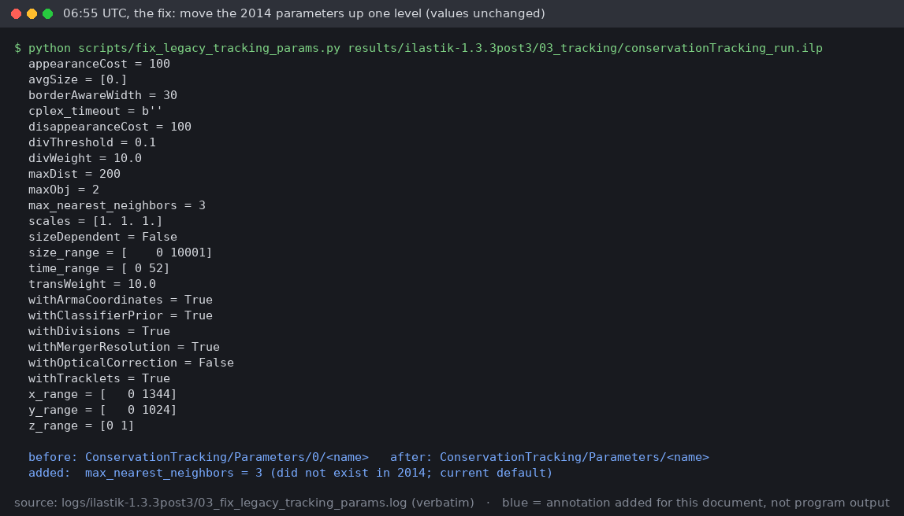

Tracking then ran in about 40 seconds and exported the label image, the object IDs, the merger image and
a CSV table.

## 6. "Maybe run it on ilastik 1.3.1 post?"

This request arrived while the 1.5 tracking was finishing. The reasoning: the projects were built for
an older ilastik, and patching them for an alpha release leaves room for doubt.

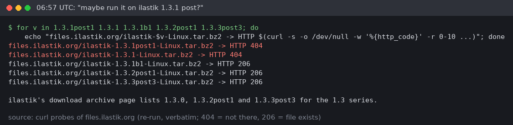

There is no 1.3.1 release in ilastik's archive, only a beta. The closest release, 1.3.2post1, crashed:

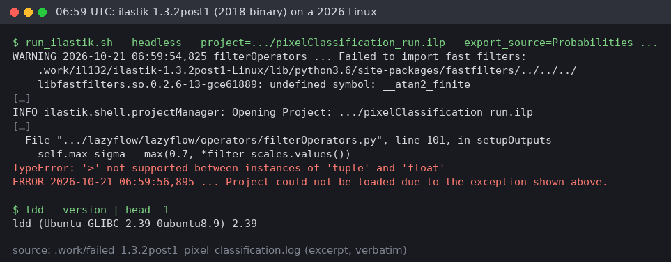

> **Look at the first warning.** Is this crash about the MitoCheck project?
>
> <details><summary>Answer</summary>
>
> Mostly not. The crashing line only runs when ilastik's bundled "fast filters" library fails to import
> and ilastik falls back to vigra's filters. Here it fails because the 2018 binary needs a C-library
> symbol (`__atan2_finite`) that today's Linux (glibc 2.39) no longer provides. That fallback path
> then mishandles 2D data. [Inference] On a 2018-era system the fast filters would have loaded and
> this code wouldn't run, which fits the memory that it "was fine back then". This was not tested.
> </details>

(A shorter dead end on the way: conda still has the 1.3.3 package itself but not its dependencies, so
it installed and then couldn't import `h5py`.)

The last 1.3 release, **1.3.3post3**, opened the 2014 pixel classification project **without any
changes**. The tracking project still needed the parameter fix, so that layout change predates 1.3.3
and isn't a 1.5 quirk.

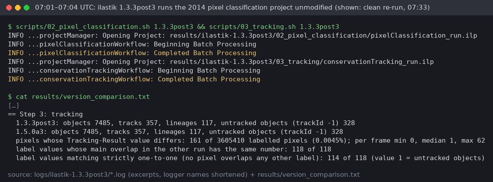

That made 1.3.3post3 the main run, with 1.5.0a3 kept as the comparison. All steps were then scripted
([`scripts/run_all.sh`](scripts/run_all.sh)) and re-run from a clean state, so the committed results
come from the committed code. The full run took 29.5 minutes on 4 CPU cores, most of it compressing
files losslessly so they fit on GitHub.

---

## 7. Results

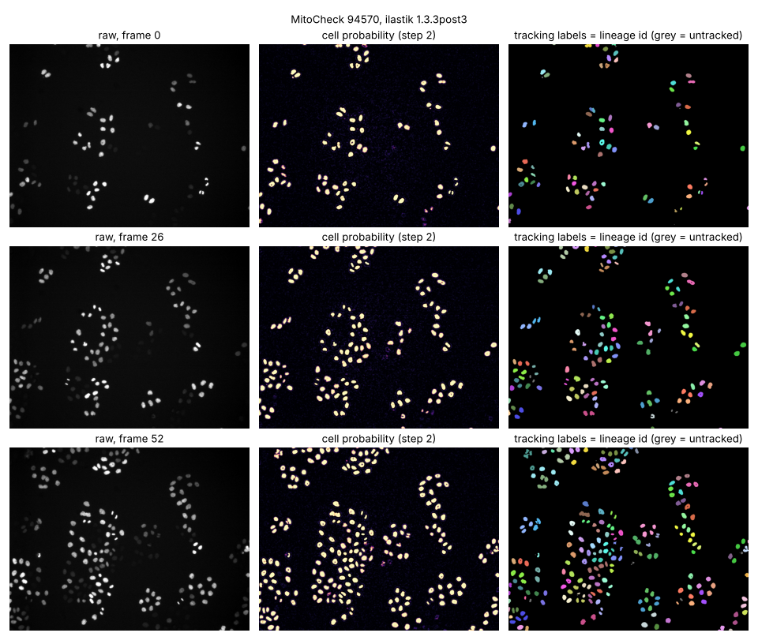

| | ilastik 1.3.3post3 | ilastik 1.5.0a3 |
|---|---|---|
| objects detected (all frames) | 7,485 | 7,485 |
| tracks / lineages | 357 / 117 | 357 / 117 |
| division events | 120 | 120 |
| detected but not tracked | 328 | 328 |
| cells per frame (tracked + untracked) | 80 → 232 | 80 → 232 |
| cell-mask IoU vs. the 2014 probability map | 99.776% | 99.776% |

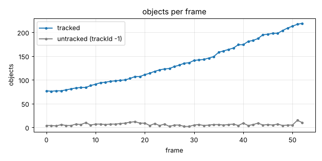

> **Trap:** both versions agree with the 2014 probability map on **99.989%** of pixels. Impressive?
>
> <details><summary>Answer</summary>
>
> Less than it sounds. Nuclei cover 5% of each frame, so a map that called *everything* background
> would still agree on about 95% of pixels. The fairer number is the IoU on the cells themselves
> (pixels called cell in both maps ÷ pixels called cell in either): **99.776%**. Still very close, and
> now the number is about cells.
> </details>

> **Trap:** count the distinct non-zero values in the Tracking-Result image and you get 118. How many
> lineages are there?
>
> <details><summary>Answer</summary>
>
> 117. Value **1** is not a cell: it marks every object that was detected but not linked into any
> track (`trackId = -1` in the CSV table). Real lineages are values 2–118.
> </details>

### 1.3.3post3 vs 1.5.0a3, frame by frame

Same colour = same lineage number; magenta circles mark pixels whose label differs between versions:

<p align="center">
  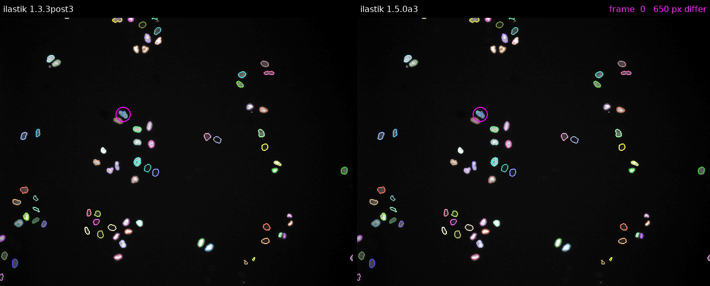
</p>

Only **161 of 3.6 million labelled pixels** differ (0.0045%). Most frames have 0 or 1. The largest
disagreement is in frame 44:

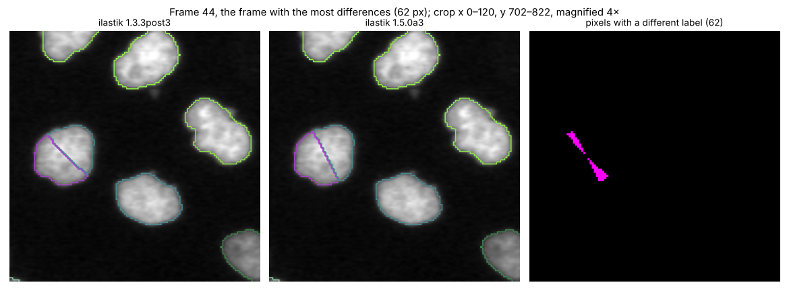

Here two touching nuclei were detected as one blob, and ilastik's merger resolution split it into two
cells. The two versions draw the dividing line a little differently. 137 of the 161 differing pixels
are cases like this; the other 24 are edge pixels that one version calls cell and the other
background.

## Two things Claude got wrong on the way

- Claude told me the two versions numbered their lineages differently, so the GIF colours wouldn't
  match. It hadn't checked. They number them identically, and the side-by-side GIF uses that.
- Claude wrote in the repository that 1.3.2post1 "crashes on this project". The log shows it crashes
  because of today's system library, not because of the project (chapter 6). The repository text is
  corrected.
- Not wrong, but worth noting: Claude's first summary led with "99.989% pixel agreement". The cell IoU
  (chapter 7) came later, when building the side-by-side comparison.

## Notes for an LLM-benchmark discussion

This session is one example of an LLM agent doing a bioimage analysis task end to end. Observations from
it, for judging such output as an analyst would:

- **What the agent did without help:** found an install route around blocked hosts; traced both legacy
  format problems (label axis order, tracking parameter layout) by reading ilastik's source code;
  scripted every step so the results can be re-run; stored the outputs losslessly within GitHub's size
  limits.
- **What needed the human:** network access (an environment setting the agent cannot change), and the
  domain-informed suggestion to try an older ilastik, which produced the main result.
- **Where it went wrong:** statements made without checking (the two above), and a headline metric that
  flattered the result because background dominates the image.
- **Judgment calls the agent made that an analyst should review:** `max_nearest_neighbors = 3` for the
  2014 tracking; treating 1.3.3post3 as the reference run; linking the 2014 probability map so the
  tracking project would open.
- **What was not done:** no comparison against ground truth. The zip contains `manualTracking.ilp`,
  which may hold hand-made tracks that could serve as a reference for tracking accuracy. [Unverified]
  It has not been opened.

## Still open

- **ilastik 1.3.1 itself** was not run: it isn't in the public archive. If you have the 1.3.1 binary,
  dropping it into `.work/` and adding it to `scripts/env.sh` is all it needs.
- **1.3.2post1** could probably be made to run here by supplying the missing `__atan2_finite` symbol to
  the old fast-filters library. Not tried.
- **`max_nearest_neighbors = 3`** is today's default, not a 2014 value; the 2014 tracking may have
  behaved differently. [Unverified]
- **1.5.0a3 is an alpha**, and its pixel probabilities differ from 1.3.3's by up to 0.12 even though both
  use the same project. The cause was not investigated.

## Group discussion

Discussion for Group 5 and the workshop happens in the
[issue tracker](https://github.com/Daniel-Waiger/GLOBIAS-2026-GROUP-5/issues). Start with the issue labelled
`start-here`. **New issue** offers forms for a discussion topic, an Assignment I LLM-benchmark entry
(one per LLM answer), an Assignment II consensus experiment (one per dataset and combination rule),
meeting notes, and problems with the pipeline.

## Companion: the Shape Analysis Field Guide

The second strand of this group's work is shape analysis, the step after segmentation and tracking:
turning each outline into numbers that ignore where a cell sits, how big it is and which way it points,
so that populations can be averaged, compared and classified.

- **[Daniel-Waiger/shape-analysis-field-guide](https://github.com/Daniel-Waiger/shape-analysis-field-guide)**
  — a plain-language, illustrated guide in eleven chapters, with a tested Python
  re-implementation of every method (`shapekit`), 27 generated figures and animations, and a reader site
  with six interactive demos, published at
  **<https://daniel-waiger.github.io/shape-analysis-field-guide/>**. It adapts the EMBL-EBI tutorial
  [Shape Analysis 101](https://github.com/uhlmanngroup/shapeanalysis101) by Johannes Hugger and
  Virginie Uhlmann (2021).
- **[Phenotype Lab](https://daniel-waiger.github.io/shape-analysis-field-guide/lab/)**, the guide's
  chapter 10: whether shape alone can classify a phenotype, on six labeled datasets (live vs dead worms,
  wild-type vs lamin-deficient fibroblasts, a comparison the lab shows is confounded with the cells'
  growth substrate, schizophrenia vs control brain landmarks, female vs male
  gorilla skulls, 15 leaf species, sickle-cell erythrocytes), with landmark, spline and PointNet methods
  side by side against a size-only baseline. Every number comes from a script in the guide's repository;
  you can drag a shape and watch the classifier respond, in the browser or on a phone. The
  [chapter text](https://daniel-waiger.github.io/shape-analysis-field-guide/#10) reports the results
  as they came out, including one below chance.
- **[docs/shapeanalysis101_explained.md](docs/shapeanalysis101_explained.md)**, in this repository: the
  file-by-file reading of that tutorial that the guide was built from, including the bugs found in it
  (a centering step that averages over the wrong axis, a network that never leaves evaluation mode, a
  comment that outlived the code it described) and, in the guide's chapter 09, why each one happened.

Both were produced the same way as the ilastik run above, in Claude Code cloud sessions with the work
split across reading, writing, engineering and design agents and every claim re-checked against the
source, so they belong to the same LLM-benchmark discussion as Assignment I.

## Reproduce

```bash
scripts/run_all.sh                          # download, install both ilastik versions, run steps 2–6
.work/mamba/envs/ilastik/bin/python docs/chronicle/make_images.py   # images on this page
```

Repository layout:

```
data/mitocheck_2d+t/        the example as downloaded (originals, untouched)
scripts/                    one script per step + the fixes for the 2014 projects
results/ilastik-<version>/  02_pixel_classification, 03_tracking, 04_previews
results/                    version_comparison.txt, side_by_side_tracking.gif
logs/ilastik-<version>/     every ilastik call
docs/REFERENCE.md           file formats, fixes, the arithmetic in the scripts
docs/chronicle/             excerpts and images used on this page
```

*Data courtesy of the MitoCheck project ([mitocheck.org](http://www.mitocheck.org)), movie 94570;
example and projects from [ilastik](https://www.ilastik.org).*
